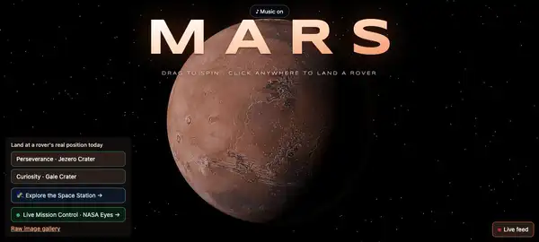

<h1 align="center">ROVER · Explore Mars</h1>
<p align="center">Spin Mars, land a rover where it really is today, and browse the newest raw images straight from NASA.</p>
<p align="center"><a href="https://mars-satellites-alpha-orpin.vercel.app"></a></p>

<a href="https://mars-satellites-alpha-orpin.vercel.app"></a>

## What's inside
| Page | What it does |
|:--|:--|
| **Mars** (`index.html`) | A 3D Mars you can drag to spin. Land NASA's Perseverance (Jezero Crater) or Curiosity (Gale Crater) at its real position, or click anywhere to land a rover there. |
| **Gallery** (`gallery.html`) | The latest raw images from Curiosity and Perseverance, pulled live from NASA's raw image feeds. |
| **Mission Control** (`mission.html`) | Upcoming Mars relay passes: the windows when an orbiter flies over a rover to send its data home, from NASA's MaROS schedule. |
| **Space Station** (`stations.html`) | NASA's 3D model of the ISS, with its live position from the Where the ISS At? API. |

## Built with
Three.js (r160) with GLB models of Perseverance and the ISS. Plain HTML and JS, with no build step.

**Data:** NASA Mars raw image APIs · NASA Eyes / MaROS relay schedule · NASA GIBS Earth imagery · wheretheiss.at

## Run it locally
```bash
python3 -m http.server 8000   # then open http://localhost:8000
```

<p align="center"><sub>Built by <a href="https://github.com/Amritanshu-nirjhar">Amritanshu Nirjhar</a> · more at the <a href="https://amritanshu-portfolio-beryl.vercel.app">portfolio ↗</a></sub></p>
